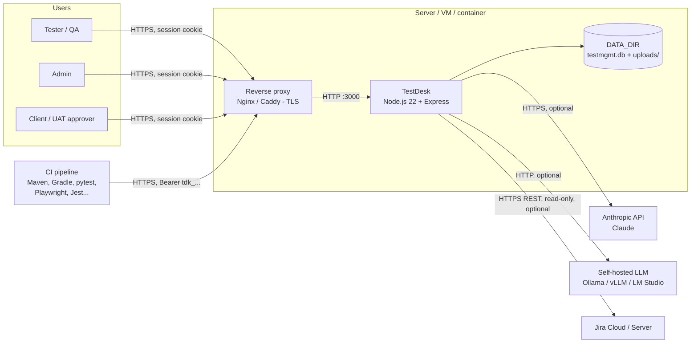
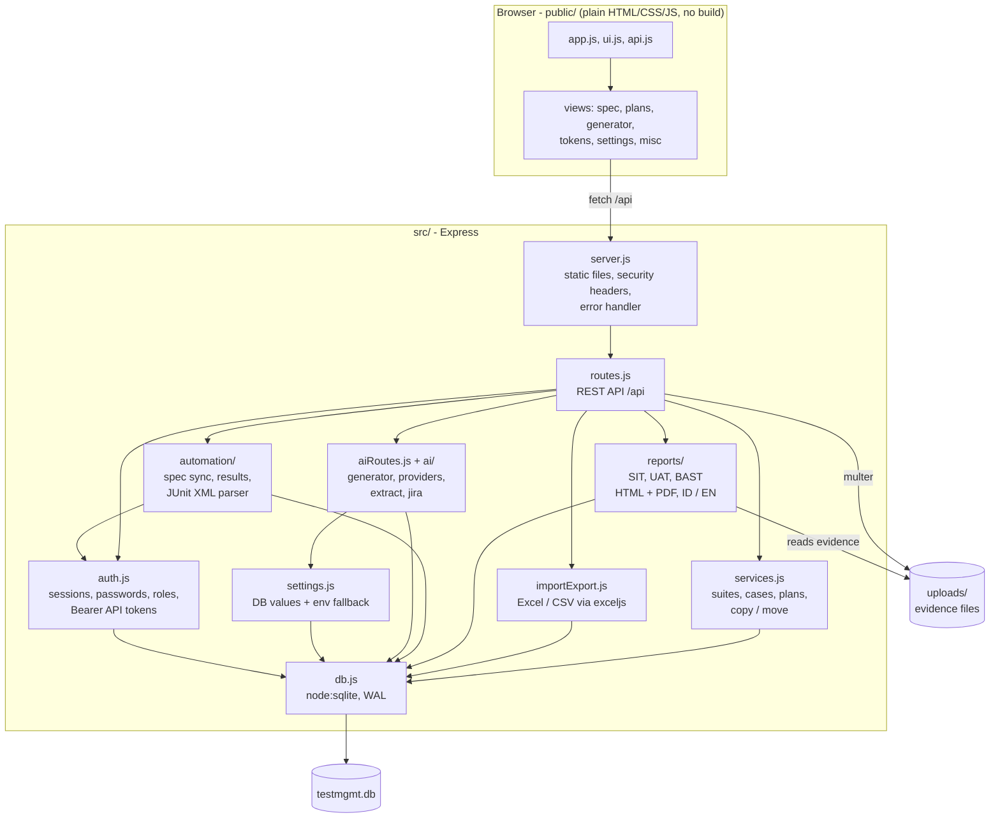
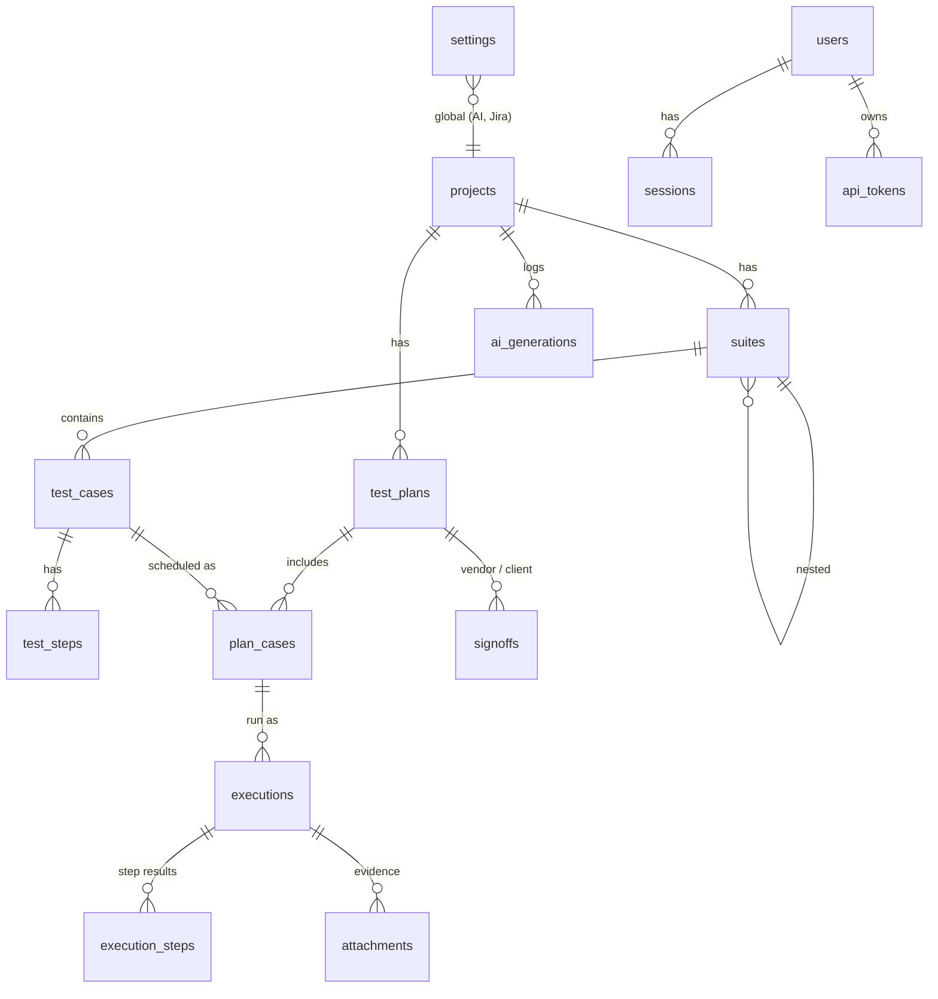
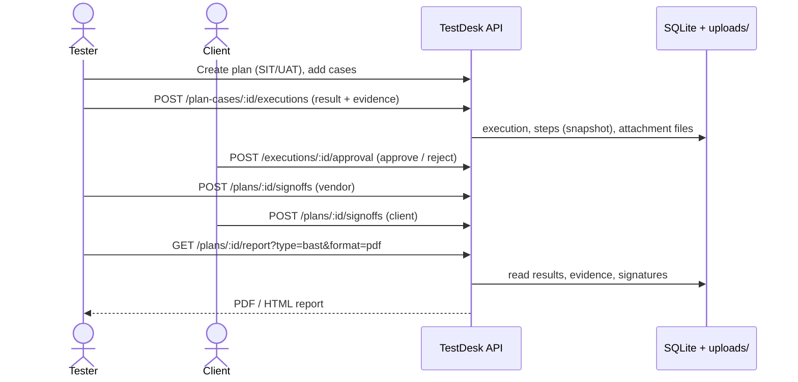
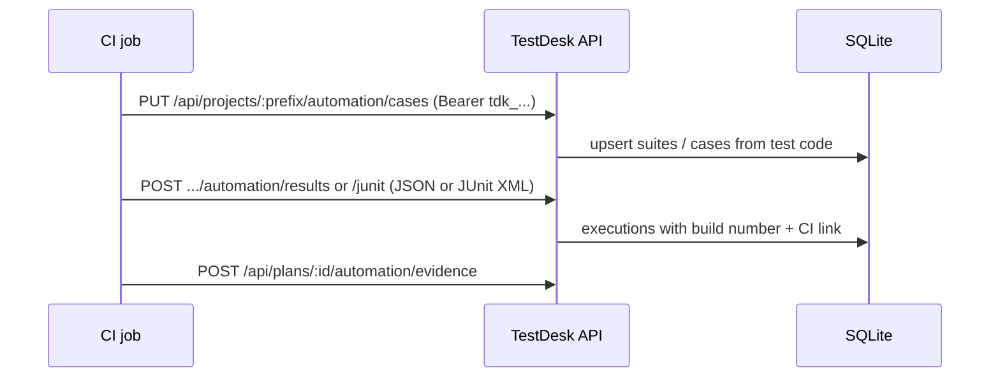
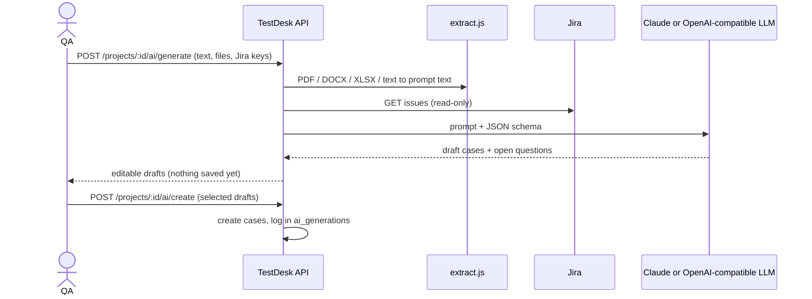

# Architecture

TestDesk is a single Node.js process: an Express app serving a JSON API and a static, build-free web UI, backed by SQLite and a folder of evidence files. There is no separate database server, queue or cache.

## 1. System context

## 2. Internal components

## 3. Data model

## 4. Key flows

### SIT / UAT execution, approval and BAST

### CI automation

### AI test case generation

## 5. Design notes

| Topic | Decision |
|-------|----------|
| Storage | SQLite file (`node:sqlite`, WAL mode) + `uploads/` folder, both under `DATA_DIR` |
| Scaling | Single process, single writer. Scale **up**, not out. Do not run multiple instances against one `DATA_DIR` |
| Auth | HttpOnly `SameSite=Lax` session cookie for browsers; `Authorization: Bearer tdk_...` tokens for CI |
| Roles | Admin, Tester, Client (see README) |
| Secrets | AI/Jira keys can live in the DB (Settings) or in environment variables |
| Frontend | Static files served by Express; no build step |
