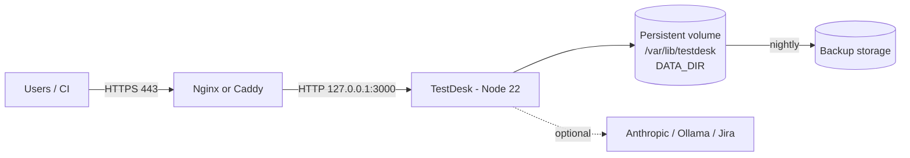

# Deployment Guide

TestDesk runs as one Node.js process with all state in a single directory (`DATA_DIR`). That makes deployment simple: run the process, put HTTPS in front, and back up the directory.

See [ARCHITECTURE.md](ARCHITECTURE.md) for diagrams.

## Deployment topology



## 1. Prerequisites

| Item | Requirement |
|------|-------------|
| Node.js | **22.13+** (uses built-in `node:sqlite`) |
| OS | Linux (Ubuntu 22.04/24.04 recommended); Windows/macOS also work |
| Resources | 1 vCPU / 1 GB RAM is enough for a small team; allow disk for evidence files |
| Network | Inbound 443 (and 80 for certificate issuance). Outbound HTTPS only if using Claude or Jira |
| Fonts (PDF) | `fonts-dejavu-core` on Linux, or set `PDF_FONT_REGULAR` / `PDF_FONT_BOLD` |
| Domain + TLS | Required in production. The session cookie has no `Secure` flag, so always terminate TLS at the proxy |

## 2. Configuration checklist

| Variable | Production value |
|----------|------------------|
| `HOST` | `127.0.0.1` (proxy on same machine) or `0.0.0.0` (container) |
| `PORT` | `3000` |
| `DATA_DIR` | Absolute path on persistent storage, e.g. `/var/lib/testdesk` |
| `ADMIN_PASSWORD` | Strong password; only used when the DB is first created |
| `MAX_UPLOAD_MB` | `25` (match proxy `client_max_body_size`) |
| `REPORT_TIMEZONE` | e.g. `Asia/Jakarta` |
| `ANTHROPIC_API_KEY` | Optional, for the AI generator |
| `AI_PROVIDER`, `AI_MODEL`, `AI_BASE_URL`, `AI_API_KEY` | Optional, for a self-hosted model |
| `JIRA_BASE_URL`, `JIRA_EMAIL`, `JIRA_API_TOKEN` | Optional |

Full list: README → *Configuration*.

## 3. Option A: Linux VM with systemd (recommended)

```bash
# 1. Node 22 and fonts
curl -fsSL https://deb.nodesource.com/setup_22.x | sudo -E bash -
sudo apt-get install -y nodejs fonts-dejavu-core git

# 2. Service user and directories
sudo useradd --system --home /opt/testdesk --shell /usr/sbin/nologin testdesk
sudo mkdir -p /opt/testdesk /var/lib/testdesk
sudo git clone https://github.com/bungezzthree/test-management-tools.git /opt/testdesk
cd /opt/testdesk && sudo npm ci --omit=dev
sudo chown -R testdesk:testdesk /opt/testdesk /var/lib/testdesk
```

Environment file `/etc/testdesk.env` (`chmod 600`, owner root):

```ini
HOST=127.0.0.1
PORT=3000
DATA_DIR=/var/lib/testdesk
ADMIN_PASSWORD=change-me-to-a-strong-password
REPORT_TIMEZONE=Asia/Jakarta
# ANTHROPIC_API_KEY=sk-ant-...
```

Unit file `/etc/systemd/system/testdesk.service`:

```ini
[Unit]
Description=TestDesk test management
After=network.target

[Service]
User=testdesk
WorkingDirectory=/opt/testdesk
EnvironmentFile=/etc/testdesk.env
ExecStart=/usr/bin/node --disable-warning=ExperimentalWarning src/server.js
Restart=on-failure
NoNewPrivileges=true
ProtectSystem=full
ReadWritePaths=/var/lib/testdesk

[Install]
WantedBy=multi-user.target
```

```bash
sudo systemctl daemon-reload
sudo systemctl enable --now testdesk
curl -I http://127.0.0.1:3000/
```

### Reverse proxy with HTTPS

**Caddy** (automatic certificates), `/etc/caddy/Caddyfile`:

```
testdesk.example.com {
    request_body {
        max_size 40MB
    }
    reverse_proxy 127.0.0.1:3000 {
        transport http {
            response_header_timeout 10m
        }
    }
}
```

**Nginx** (with certbot):

```nginx
server {
    listen 443 ssl;
    server_name testdesk.example.com;
    # ssl_certificate / ssl_certificate_key from certbot

    client_max_body_size 40m;        # AI generator accepts up to 10 files
    proxy_read_timeout 600s;         # AI generation can take minutes

    location / {
        proxy_pass http://127.0.0.1:3000;
        proxy_set_header Host $host;
        proxy_set_header X-Forwarded-For $remote_addr;
        proxy_set_header X-Forwarded-Proto $scheme;
    }
}
```

## 4. Option B: Docker

The repository has no Dockerfile yet. Add this `Dockerfile`:

```dockerfile
FROM node:22-slim
RUN apt-get update && apt-get install -y --no-install-recommends fonts-dejavu-core \
    && rm -rf /var/lib/apt/lists/*
WORKDIR /app
COPY package*.json ./
RUN npm ci --omit=dev
COPY . .
ENV HOST=0.0.0.0 PORT=3000 DATA_DIR=/data
VOLUME /data
EXPOSE 3000
USER node
CMD ["node", "--disable-warning=ExperimentalWarning", "src/server.js"]
```

and `docker-compose.yml`:

```yaml
services:
  testdesk:
    build: .
    restart: unless-stopped
    ports:
      - "127.0.0.1:3000:3000"
    environment:
      ADMIN_PASSWORD: ${ADMIN_PASSWORD}
      REPORT_TIMEZONE: Asia/Jakarta
      ANTHROPIC_API_KEY: ${ANTHROPIC_API_KEY:-}
    volumes:
      - testdesk-data:/data
volumes:
  testdesk-data:
```

```bash
docker compose up -d --build
```

Make sure the `/data` volume is writable by the `node` user (the named volume is by default). Put the Caddy/Nginx proxy from section 3 in front.

## 5. First-run checklist

1. Open `https://testdesk.example.com` and log in as `admin`.
2. **Change the admin password** (user menu → Change password).
3. Create real users (Tester, Client); do **not** run `npm run seed` in production (or delete the demo users and project afterwards).
4. Create the project; set client/vendor names and ID prefix.
5. Admin → **Settings**: configure AI and Jira if needed, and use *Test* buttons.
6. Create an API token (Tokens) for CI; see [AUTOMATION.md](AUTOMATION.md).
7. Generate a sample report (PDF) to confirm fonts render.

## 6. Backup and restore

State = `DATA_DIR` (`testmgmt.db`, `testmgmt.db-wal`, `testmgmt.db-shm`, `uploads/`).

Simplest: stop, copy, start (as in the README).

Online backup nightly (cron, as root):

```bash
#!/bin/sh
set -e
D=/var/lib/testdesk; B=/backup/testdesk/$(date +%F)
mkdir -p "$B"
sqlite3 "$D/testmgmt.db" ".backup '$B/testmgmt.db'"   # consistent snapshot, WAL-safe
rsync -a "$D/uploads/" "$B/uploads/"
find /backup/testdesk -maxdepth 1 -mtime +30 -exec rm -rf {} +
```

Requires `sqlite3` CLI (`apt-get install sqlite3`). Restore: stop the service, put the files back in `DATA_DIR`, fix ownership, start.

## 7. Upgrade

```bash
cd /opt/testdesk
# back up first (section 6)
sudo -u testdesk git pull
sudo -u testdesk npm ci --omit=dev
sudo systemctl restart testdesk
```

Schema changes are applied automatically on start (`CREATE TABLE IF NOT EXISTS` plus migrations in `src/db.js`). Docker: `git pull && docker compose up -d --build`.

## 8. Security hardening

- Always serve over HTTPS; bind the app to `127.0.0.1` behind the proxy.
- Keep `/etc/testdesk.env` unreadable by others. Prefer environment variables over storing API keys in Settings if the DB is widely backed up.
- Restrict the host firewall to 80/443 (and SSH).
- With a self-hosted LLM, keep it on a private network so requirements never leave your infrastructure.
- Run as a non-root user and keep Node.js patched.
- Test and CI tokens (`tdk_...`) should be per-pipeline and revoked when no longer needed.

## 9. Operations

| Task | Command |
|------|---------|
| Status / logs | `systemctl status testdesk`, `journalctl -u testdesk -f` |
| Docker logs | `docker compose logs -f testdesk` |
| Health check | `curl -fsS -o /dev/null http://127.0.0.1:3000/` |
| Run tests | `npm test` (dev only) |

## 10. Troubleshooting

| Symptom | Likely cause / fix |
|---------|--------------------|
| `node:sqlite` module not found | Node older than 22.13; upgrade |
| Cannot reach from other machines | `HOST` is `127.0.0.1`; use the proxy or `0.0.0.0` |
| Evidence upload fails (413) | Raise `MAX_UPLOAD_MB` and the proxy body limit |
| AI generation returns 502/504 | Proxy timeout too low; raise `proxy_read_timeout` |
| PDF shows boxes instead of text | Install `fonts-dejavu-core` or set `PDF_FONT_*` |
| Lost data after container restart | `DATA_DIR` not on a persistent volume |
| Database locked / corrupted | More than one instance on the same `DATA_DIR`; run only one |
